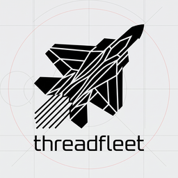

# ThreadFleet

[](https://github.com/wzxmer/ThreadFleet)

[中文](#threadfleet) | [English](#threadfleet-1)



ThreadFleet 是一个基于 Tauri 的开源 Codex Agent 桌面工作台，用来协调本地项目、会话、Git 变更、提示词和远程后端，支持 Windows、macOS 和 Linux。

关键词：ThreadFleet、Codex 桌面客户端、Codex 多会话管理、Codex Agent 工作区管理。

## 项目来源与许可

ThreadFleet 是基于 [Thomas Ricouard](https://github.com/Dimillian) 开发的 [CodexMonitor](https://github.com/Dimillian/CodexMonitor) 衍生而来的独立开源项目，继续采用 [MIT 许可证](LICENSE)。原项目版权声明与许可文本完整保留。

ThreadFleet 与 OpenAI 及原 CodexMonitor 项目不存在隶属、赞助或官方背书关系。`Codex` 仅用于说明兼容的工具和工作流。

## 下载

ThreadFleet 安装包可在 [Releases](https://github.com/wzxmer/ThreadFleet/releases) 页面下载；也可以按下方说明从源码构建：

- Windows: `.exe` / `.msi`
- macOS: `.dmg`
- Linux: `.AppImage` / `.rpm`

Windows 默认继续使用与当前安装相同的格式更新：`.exe` 对应 NSIS，`.msi` 对应 MSI。“设置 > 关于”提供默认关闭的实验性 NSIS→MSI 迁移选项；只有本机安装归属、目标 MSI 和隔离验证门全部通过后才会下载但不直接打开 MSI，并要求用户再次确认。当前发布版的迁移执行门保持关闭，因此启用该选项仍会使用原安装器类型。应用检测到两种格式共存或安装器归属不明时会停止自动更新，并提供“查看修复”。只有当前 MSI 健康且仅存在一个可验证的旧 NSIS 残留时才允许修复；无法验证旧 `.lnk` 快捷方式等状态会保持只读阻止。迁移和修复都不会运行旧卸载器；操作前仍建议备份重要数据。

macOS 版本当前采用完整 ad-hoc 签名，但尚未使用 Apple Developer ID 公证。首次启动若被 Gatekeeper 阻止，请在“应用程序”中右键 ThreadFleet 并选择“打开”，或前往“系统设置 > 隐私与安全性 > 仍要打开”；正常情况下无需执行 `xattr` 命令。

## 主要增强

- 中文界面：侧边栏、设置、消息、提示、按钮和常用状态文案中文化。
- CLI 复用与引擎切换：在“设置 > Codex > CLI 与引擎”自动检测本机 Codex/Gemini CLI，选择检测到的版本，或浏览、手动输入可执行文件路径。自动模式优先本机 Codex，找不到时使用 TF 已安装的最新托管版本；已有明确路径继续固定，选择“自动检测”才恢复自动模式。新会话输入区可手动选择 Codex 或 Gemini，也可设置默认引擎；已有会话保留原引擎。Gemini 需自行安装并支持 `--acp`；可沿用终端原生登录，或在服务商设置中选择“Gemini（原生接口）”，填写支持 Gemini 原生接口的中转地址、API 密钥及可选默认模型，保存并启用。TF 将配置传入 Gemini 子进程，保留原生登录配置；模型列表在会话输入区刷新。Gemini 思考设置沿用 CLI 的官方默认值及原生用户、项目 settings；当前 ACP 接口没有会话内思考等级选择，模型列表获取成功也不会出现 Codex 的思考等级控件。TF 支持流式输出、工具审批、停止、历史恢复、重命名和归档，暂不支持 Gemini 分叉、回滚、审查或手动压缩。TF 创建的 Gemini 会话保存在项目会话列表中，原生 Gemini 历史文件的导入仍未开放。
- 视觉统一：设置页、侧栏、消息区和弹层控件改为更一致的桌面软件风格。
- 多 Agent 与进度同步：多 Agent 能力默认开启；用户明确要求并行、分工或子会话后，AI 可以自动创建和管理子任务，普通任务默认在主会话完成。“设置 > Agents > 子会话进度同步”默认关闭 TF 额外注入，子会话结果仍通过原生工具回传；需要实时汇报时，可手动选择仅最终结果、关键检查点或持续同步。旧版同步设置首次升级会重置为关闭，之后手动选择的模式会保留；已写入历史的检查点不会自动删除。
- 对话显示：统一使用原生阅读样式；默认亮色，可切换暗色，暗色模式使用统一原生暗色外观。
- 字体体验：默认使用 `PingFang SC` / 内置 `Noto Sans SC Variable` / `Microsoft YaHei UI` 字体链，中文显示更圆润饱满；支持 UI、会话、过程状态、代码四类字号独立调整，UI 字号同步覆盖侧栏、设置、工具栏、弹层和输入区。
- 模型服务商管理：按“服务商 > 分组 > API 密钥”管理连接、模型能力和多组凭据；可选自动、原生 Responses 或 Chat Completions 兼容网关传输。每个已保存 API 密钥可独立验证结构化函数工具能力，验证不会执行本地工具。第三方服务商可在设置中打开登录页；网页登录成功读取余额后会自动关闭窗口并保存 session Cookie，已有有效 Cookie 会优先复用。Key 能返回账户余额时优先使用 Key；否则 Cookie 仅补充账户余额，今日消费和平均延迟优先使用 Key。“保存”不会切换当前身份；“保存并启用”或从列表直接启用会同步切换执行与用量身份。复制服务商时保留连接与分组结构，但不复制 API 密钥、Access Token 或 session Cookie。默认在切换服务商时保留同一套本机会话，可在“设置 > 模型服务商”独立控制会话保留和 `config.toml` 同步，并通过脱敏诊断确认当前会话来源。
- 模型无关工作流：ThreadFleet 统一匹配公共 skills、agents、项目规则和知识候选；默认使用不注入模型上下文的影子模式，可在“设置 > 工作流”切换关闭、影子或启用模式，并刷新 Registry、查看脱敏诊断。关键词命中的技能仅作发现提示；显式点名技能才注入其执行指令。Agent 通过明确点名或配置的专用触发词匹配。只读检查和讨论不会仅因提到“创建、排查、检查”而启动完成验证流程；修改任务的验证按实际改动和项目规则选择。输入区支持为当前会话显式绑定 Workflow ID，绑定前会验证状态；已结束的工作流或仅支持手动检查的环境不会被标记为已绑定。
- 电脑操控路由：在“设置 > Codex > MCP”查看当前执行主机状态，并选择 Windows 操控 MCP：默认 sbroenne、CursorTouch Windows-MCP，或自定义本地 stdio 服务。填写程序路径和启动参数后应用；各提供方配置会保留，可随时切回。第三方程序需另行安装；使用 uvx 命令时会在首次启动下载依赖。切换统一使用 `windows-ui` 入口，新建或重新连接 Codex 会话后生效，已有会话不会被强制结束。依赖现有登录态的网页使用 Chrome，隔离网页使用 Browser；后端不可用时明确停止，不静默跨会话或尝试 Computer Use。自动更新仅管理 sbroenne：Windows 本地执行主机默认启动时检查官方稳定版，下载、验证和安装前仍需确认；其他提供方、非托管配置、远程主机和非 Windows 平台不会被覆盖。实际本地操控开始和任务结束（完成、失败或中断）时发送系统通知，复用系统通知设置，不包含任务内容或工具参数；远程模式不会在控制端冒充执行主机发送通知。
- 开发知识库适配：在“设置 > 工作流”查看本机 DevKnowledgeBase 的生成视图、ledger/runtime 健康与 stale 状态，运行带引用和 omitted 清单的检索；已声明但不再匹配当前源码历史的知识会自动排除并列入 omitted 清单。支持通过折叠式写入区捕获 Intake、初始化任务；所有写入经 `kb-core` 唯一入口执行，知识库或 Python CLI 不可用时客户端保持可用并明确显示降级，不在 ThreadFleet 内复制状态账本或保存 Provider 凭据。
- 用量显示：左下角 Codex 用量可开关，支持已用/剩余额度切换；用量来源可选择本机 Codex 配置，或按“服务商 > 分组 > API 密钥”显式选择。用量区与设置页双向同步当前身份，其中本机配置等同于设置中的“使用 Codex 默认配置”。第三方模型服务商可读取 Sub2 或 New API 用量，New API 可额外配置 Access Token 读取账户余额。日志不足以完整覆盖当天时会明确回退为累计消费；首页按小时、今日、近 7 天和本月汇总本机全部 Codex 会话，包含归档记录，并区分缓存读取和未缓存输入。
- 会话管理：按客户端格式、执行主机、操作系统和能力识别会话来源，以本机/归档分区展示完整元数据索引和每条会话的本地最后使用时间，可按最后使用、创建或归档日期，以及项目、来源、主会话/子 Agent、文件映射状态组合筛选并排序；未选择会话时显示当前结果的活动、项目和来源概览。进入时不读取正文，明确点击后默认定位到会话结尾，保留全部用户消息并仅展示 AI 最终答复，向上滚动可持续加载更早内容；跨项目可返回原项目或引用上下文到当前项目创建新会话，原项目已不存在时会使用独立且稳定的 `项目不存在-ABC` 临时工作区恢复。永久删除仅对已归档会话开放，并在确认后再次校验来源、归档状态、时间和精确文件映射。本机 Codex 来源在 Windows 和 macOS 均使用各自原生路径并保留完整管理能力；跨平台带入的来源不会在错误的路径命名空间中读取。WSL、远程以及 Windows/macOS 上的 Claude Code、Gemini CLI 和 OpenCode 来源，在对应 connector 或格式适配器未提供时会明确显示不可用，不读取其目录，也不开放预览、搜索、引用、归档、删除或应用内继续。
- 消息体验：编辑失败消息后重发会覆盖原消息，避免重复堆积；“自动重连”默认关闭，手动开启后仅对当前会话有效，在任务非主动中止时持续尝试恢复连接并继续，且不占用 Codex 当前任务的尝试次数；图片粘贴、拖放和预览支持悬浮复制、应用内大图查看，内部生成图片使用紧凑显示名；达到 4,000 字符或 80 行的大量文本粘贴会自动转为可预览、可恢复的 TXT 附件。
- 会话正文导出：可选择部分或全部用户/AI 消息导出为 A4 纵向 PDF 或单张 PNG；工具调用与过程状态会被过滤，消息图片保留，生成和分块保存进度可见并可取消。
- 执行结果摘要：任务结束后保留匹配执行的文件新增/删除行数和 Working 用时，在每轮最终 AI 消息的时间戳后显示该轮用时，并在会话底部汇总所有已记录回合的 Working 用时；切换会话或重启应用后仍可恢复本机已记录摘要，旧会话缺少记录时会明确标为“已记录用时”，不会补造统计。
- Git 工作流：查看改动、Diff、日志、分支、提交、推送/拉取，并支持 GitHub Issues/PR 列表与 PR 上下文提问。
- 远程后端：支持桌面 daemon、TCP/Tailscale 连接和 iOS 远程模式。
- 多会话任务协调：创建协调组绑定相关会话，声明文件/目录/逻辑资源 Ownership，阻止同一目录双写和已确认资源双写；候选检测用确定性关键词匹配并 shadow 记录已探测对，断线时保守保留写租约，不自动释放；计划面板空闲时显示协调面板。
- Shadow Router：只给出 `direct`、`delegate`、`review`、`decision-gate` 建议和原因码，不会自动派发、切换模型或修改 reasoning effort。建议仅使用当前 Provider 内已验证的模型能力，并复用任务协调的 owner、claim、lease 和冲突门；slot、depth、Token、timeout、retry、fallback 达到硬上限，模型未知或 effort 不受支持时转入 `decision-gate`。

## 功能概览

### 项目、会话与 Agent

- 添加、分组、排序和连接多个工作区。
- 可同时启动多个独立的 ThreadFleet 实例；后续启动不再只唤回已有窗口。
- 启动或恢复 Codex `app-server` 会话，显示运行中、未读、审批和用户输入状态。
- 每个工作区的普通会话列表首屏最多驻留 6 个任务，点击“加载更早会话”后每次再读取 6 个；置顶会话独立常驻，不占普通会话名额，也不受项目、项目组或普通列表收起影响。收起工作区会释放追加页和子任务展开界面，同时保留当前、置顶、运行中及等待响应的任务锚点。
- 长会话按设置数量分批显示；滚动到顶部或底部可继续加载，当前会话搜索会自动展开并定位隐藏历史，避免一次性渲染全部内容。
- 消息支持引用选中内容或整条消息到当前/新会话；引用先进入目标会话输入框草稿，由用户确认后发送；Composer 可折叠长引用、展开预览、单条移除和调整多条引用顺序；长内容可用智能引用保存为后端只读快照，按需读取，避免把全文重复塞入上下文。
- 大型文本附件、日志和 diff 会优先保存为内容寻址快照并发送轻量引用；小文件或旧版远程端继续按原方式内联。
- 新建普通 Agent、worktree Agent 和副本 Agent，隔离实验性改动。
- 子会话根据父会话主要语言生成任务标题，生成不可用时回退下发任务名；并可按“仅最终结果 / 关键检查点 / 持续同步”向父会话反馈进展，父会话运行中使用 steer 实时注入，空闲时等待下一轮，不会自动启动新 turn，已同步内容在会话中显示为轻量系统条目。
- 父会话会将子会话结果整理为精简摘要；长结果可在右侧详情面板独立阅读、复制或打开对应子会话，避免完整输出淹没总控结论。
- Pin、重命名、归档、复制、停止和中断会话。
- 本地 Codex 历史会话按项目和来源聚合，缺失项目和子代理会话可单独识别。
- ThreadFleet 与其他 Codex 客户端使用同一 `CODEX_HOME` 时默认共用会话库，无需同步开关或复制数据；在“设置 > Codex”可确认默认、独立或远程状态。两端刷新后可看到已持久化更新，不建议同时操作同一个会话。

### 输入框与模型控制

- Agent 的阻塞式结构化提问显示选择卡片，支持逐题选择、补充说明和自定义回答；切换会话保留当前请求的草稿，提交失败可重试，等待回答时暂停排队消息与自动续跑。异步结构化提问在 Agent 继续工作时也直接显示卡片，后续进度消息不会移除回答入口；启用运行中发送时可即时回答，否则等本轮结束再提交。普通文字提问的明确末尾选项列表会直接展开选择卡片，其余提问可点击“回复此问题”。异步和普通回复卡片支持选择、拖放或粘贴附件，可预览图片、移除文件；提交失败或切换会话后保留附件草稿，单题也可仅用附件回答。答案与附件连同问题上下文发送到原会话，没有默认选择。异步和普通提问不自动暂停执行；阻塞式请求结束、失效或工作区重新连接后不再提交旧请求，重启应用不恢复未提交答案。
- 附件支持选择、拖放和粘贴任意格式的文件，包括图片、PPT/PPTX、Word、Excel、PDF 和无扩展名文件。TF 不设附件格式、单文件大小或数量上限，具体读取、解析和转换方式由模型与 Agent 工具决定。原文件保存在会话附件目录，工作区外文件也可添加；实际处理能力受 Agent 环境及可用资源影响。远程模式会先上传到 daemon，需同步更新远程端。附件准备失败时不会发送消息，草稿与附件保留。
- 支持 `$` 技能、`/prompts:` 提示词、`/review`、`@` 文件路径补全。
- 可配置默认跟进行为：排队发送或在运行中 steer。
- 模型、推理强度、访问模式、协作模式和上下文用量在输入区集中控制。
- 输入框边框按当前周期 Token 与模型上下文窗口显示真实占用；压缩开始时显示运行状态，完成后更新并保留该会话的累计压缩次数。
- 重新编辑失败消息时沿用输入框当前发送快捷键规则；编辑面板使用紧凑操作区，不额外显示快捷键提示。
- `设置 > Codex > 默认参数` 提供质量、均衡、节省三档 Token 效率策略，并可设置单次工具输出写入会话历史的 Token 预算；策略仅影响新会话，输出预算在重连工作区后生效。
- 支持语音输入和按住说话快捷键。

### Git、GitHub 与文件

- 文件树搜索、图标、快速打开和 Reveal in Finder/Explorer。
- 消息中的本地文件链接单击直接打开文件；选择文件资源管理器时使用系统默认应用，HTML 文件会在默认浏览器中打开。右键菜单可打开文件所在文件夹。
- Git 状态、分文件 Diff、暂存/撤销、提交日志、分支切换和同步。
- GitHub Issues/PR 读取、PR Diff/评论查看，以及将 PR 上下文发送给 Agent。
- 全局和工作区提示词库支持创建、编辑、删除、移动和直接运行。

### 设置与体验

- 设置分区覆盖显示、输入、会话、项目、Codex、工作流、Git、功能、快捷键、更新和环境。
- 会话设置支持按空闲天数自动归档，并始终跳过当前、运行中和置顶会话；还可按 30/60/90/180 天管理归档会话永久清理，功能默认关闭，开启和立即清理都需明确二次确认，自动检查最多每 24 小时一次，并保护当前、运行中和置顶会话。
- “设置 > 会话 > 任务产物目录”可为后续任务选择统一根目录；留空使用 ThreadFleet 数据目录下的 `artifacts`，按项目和会话分目录。保存后从下一轮任务向 Codex 和 Gemini 传入输出约定，用户指定路径优先，源码与知识库保持各自归属；这不是强制文件重定向。远程模式填写执行主机路径，留空使用远端默认目录。已有产物不自动迁移，删除会话不会删除这些文件。
- Windows 的“设置 > 会话 > 统一数据目录（本机）”支持把 TF 数据、浏览器缓存、托管 CLI、默认/自定义 Codex 数据、Gemini 数据与当前任务产物迁到可自选的空目录（默认建议 `D:\ThreadFleetData`）。须使用本地 NTFS 磁盘；安排迁移时需要 Windows 管理员确认，以创建兼容系统信任检查的目录联接。所有 TF、相关 Agent 客户端及数据目录内运行的插件退出后才复制、校验并切换；使用 Chrome 插件时也须完全退出 Chrome，关闭到托盘不算退出。原路径通过目录联接继续有效。若系统拒绝目录联接，预检会停止迁移并保留原数据。检查会话、附件和设置后，可单独安排清理旧副本以释放原盘空间。项目源码、外部 CLI 安装和系统临时目录不在迁移范围，远程主机须单独管理。
- 迁移失败后可重试。目标副本中多出的未知、已变化或持久文件会保留在所选数据目录的 `.tf-retry-preserved-*` 子目录，供核查；这些保留项不会自动清理。仅已验证且未变化的过期临时副本会在重试时移除。
- 同处的“定期释放空间”可启用退出后的自动维护，设置 7–365 天保留期（默认 30 天），每天最多检查一次。仅清理 TF 浏览器的可再生缓存和新任务 `.threadfleet-tmp` 中有明确标记的过期临时文件，并显示最近释放的空间；会话、附件、登录信息、正式报告、部署/回滚备份、迁移旧副本和历史未标记产物不会自动清理。此约定不强制 Agent 的写入路径，会话留存仍由独立设置管理。停用后停止后续检查，已开始的检查会先完成；只在使用 TF 并随后完全退出时触发，不安装系统定时任务。
- UI 缩放、字体、字号、字重、透明效果、消息文件路径、工具折叠、Diff 预加载等可配置。
- 侧栏、右侧面板、计划面板、终端和调试面板尺寸持久化。
- 通知声音、长任务完成系统通知（窗口聚焦或后台均显示）、更新提示、调试日志复制和清空。
- TF、Codex CLI 和电脑操控 MCP 的新版提示统一显示在右下角，可各自关闭；检查中和已是最新时不显示。更新过程继续显示进度和结果。本地 sbroenne 修补版也会检查官方新版，但需先核对并保留输入修复，不直接覆盖安装。
- 应用更新默认从 GitHub 下载；Windows 优先使用当前用户系统代理或 PAC，随后尝试环境代理和直连；其他平台尝试环境代理后直连。GitHub 下载线路失败后，发布者配置的腾讯 COS、阿里 OSS 镜像按序重试，并校验安装包大小与 SHA-256。
- Codex CLI 与软件更新使用独立更新链路。点击“检查更新”会同时检查应用和 CLI，并分别显示结果；本机 CLI 有新版时自动开始更新，无需额外安装或配置。由 ThreadFleet 安装的 CLI 直接检查 OpenAI 官方 CLI Release，下载、校验完整包后自动保存新版路径；新连接使用新版，已有连接在任务空闲后自动切换，正在运行的任务不受影响。其他受支持的安装调用 `codex update` 原地更新，自定义安装不会被静默覆盖。正式版启动时按自动检查开关执行 CLI 更新；首次应用检查遇到短暂失败会自动重试一次。
- 桌面/平板/手机响应式布局，iOS 走远程后端模式。

## 环境要求

- Node.js + npm
- Rust stable toolchain
- CMake
- Windows 构建需要 LLVM/Clang（`bindgen` / `libclang`）
- Codex CLI 可在 `PATH` 中作为 `codex` 运行，或在设置中指定自定义路径
- Git CLI
- GitHub CLI `gh`（可选，用于 Issues/PR 功能）

遇到原生依赖或环境问题时运行：

```bash
npm run doctor
```

## 本地开发

安装依赖：

```bash
npm install
```

启动桌面开发模式：

```bash
npm run tauri:dev
```

常用验证：

```bash
npm run typecheck
npm run test
npm run lint
cd src-tauri && cargo check
```

Windows PowerShell 下需要限制测试并发时，使用 `npm.cmd` 转发参数：

```powershell
npm.cmd run test -- --maxWorkers=1 --minWorkers=1
```

生产构建：

```bash
npm run tauri:build
```

Windows 专用构建：

```bash
npm run tauri:build:win
```

产物位于 `src-tauri/target/release/bundle/`。

Release 工作流统一使用 `src-tauri/tauri.conf.json` 中的合法 SemVer 作为包内版本、GitHub Tag、Release 标题、下载链接和公开资产版本。`v0.8.01` 与 `v0.8.02` 为历史版本；后续版本从 `v0.8.13` 继续递增。

### 国内更新镜像（可选）

镜像全部未配置时保持 GitHub-only，不影响构建。启用镜像时，在 GitHub `release` Environment 配置：

- Variables：`TENCENT_UPDATE_BASE_URL`、`TENCENT_UPDATE_MANIFEST_URL`、`TENCENT_COS_BUCKET`、`TENCENT_COS_REGION`
- Secrets：`TENCENT_COS_SECRET_ID`、`TENCENT_COS_SECRET_KEY`
- Variables：`ALIYUN_UPDATE_BASE_URL`、`ALIYUN_UPDATE_MANIFEST_URL`、`ALIYUN_OSS_BUCKET`、`ALIYUN_OSS_ENDPOINT`
- Secrets：`ALIYUN_OSS_ACCESS_KEY_ID`、`ALIYUN_OSS_ACCESS_KEY_SECRET`
- Variables：`TENCENT_CODEX_CLI_BASE_URL`、`TENCENT_CODEX_CLI_MANIFEST_URL`
- Variables：`ALIYUN_CODEX_CLI_BASE_URL`、`ALIYUN_CODEX_CLI_MANIFEST_URL`

`*_UPDATE_BASE_URL` 是公开下载根地址，`*_UPDATE_MANIFEST_URL` 通常为该根地址下的 `latest.json`。发布流程会生成版本目录、校验值和清单，并仅在对应配置完整时上传。Release 在构建前审计两家镜像配置并写入 Actions Summary；半配置、非 HTTPS 公共地址、只有下载线路但缺少上传凭据，都会直接阻止发布，避免生成无法回退的安装包。

首次未检测到 CLI 时，可在软件内安装对应平台的完整 package。ThreadFleet 管理的 CLI 后续更新独立查询 OpenAI 官方 CLI Release，不依赖 ThreadFleet 的发版或 CLI 打包清单；下载包校验通过且实际版本匹配后，软件自动保存新版路径。下载或校验失败时保持旧版可用。其他安装继续通过当前 CLI 的 `doctor --json` 检查并执行 `codex update`；自定义安装和无法自行更新的安装会显示限制。远程模式只检查远程主机版本，更新需在该主机执行。

CLI 更新默认在后台运行，可继续使用主界面；进度提示可关闭，也可在“设置 > Codex > MCP”的 CLI 更新区重新查看详情。关闭提示不会取消更新，完成后不会强制打开弹窗。托管下载显示系统代理、环境代理或直连，以及下载、解压和验证阶段；Windows 优先使用当前系统代理/PAC，读取连续 30 秒无响应时尝试后续连接方式。Clash 的节点和规则仍由 Clash 管理。

Windows 已覆盖本机运行验证。macOS 会按 Apple Silicon、Intel 和 Rosetta 选择托管包，Linux 与远程 daemon 在各自执行主机检查版本；这些非 Windows 路径仍需对应设备的发布后反馈验证，远程模式不会在控制端替远程主机安装。

## 远程后端与 iOS

iOS 当前以远程后端为主：手机端连接桌面或服务器上的 ThreadFleet daemon。桌面端默认仍是本地优先。

### Tailscale TCP 连接

1. 桌面和 iPhone 登录同一个 Tailscale tailnet。
2. 桌面 ThreadFleet 打开 `设置 > 服务器`。
3. 设置 Remote backend token。
4. 启动 Mobile access daemon。
5. 使用 Tailscale helper 检测主机地址，例如 `your-mac.your-tailnet.ts.net:4732`。
6. iOS 端填写同一个主机地址和 token。
7. 点击连接测试。

桌面 daemon 必须保持运行；连接失败时先检查 Tailscale 在线状态、地址和 token。

### 无桌面 UI 的 daemon 管理

```bash
cd src-tauri
cargo build --bin codex_monitor_daemon --bin codex_monitor_daemonctl
./target/debug/codex_monitor_daemonctl status
./target/debug/codex_monitor_daemonctl start
./target/debug/codex_monitor_daemonctl stop
```

常用参数：

- `--data-dir <path>`: 指定包含 `settings.json` / `workspaces.json` 的数据目录
- `--listen <addr>`: 覆盖监听地址
- `--token <token>`: 覆盖 token
- `--daemon-path <path>`: 指定 daemon 二进制路径
- `--json`: 输出机器可读 JSON

### iOS 构建

安装目标：

```bash
rustup target add aarch64-apple-ios aarch64-apple-ios-sim
```

模拟器：

```bash
./scripts/build_run_ios.sh
```

真机：

```bash
./scripts/build_run_ios_device.sh --list-devices
./scripts/build_run_ios_device.sh --device "<device name or identifier>" --team <TEAM_ID>
```

TestFlight 发布脚本：

```bash
./scripts/release_testflight_ios.sh
```

本地签名配置优先放在 `src-tauri/tauri.ios.local.conf.json`。

## 项目结构

```text
src/
  features/                         前端功能模块
  features/app/bootstrap/           启动和恢复编排
  features/app/orchestration/       布局、线程、工作区编排
  features/threads/hooks/           会话状态和消息 reducer
  services/                         Tauri IPC 封装
  styles/                           按区域拆分的 CSS
  types.ts                          前端共享类型
src-tauri/
  src/lib.rs                        Tauri 命令注册
  src/bin/codex_monitor_daemon.rs   远程 daemon 入口
  src/bin/codex_monitor_daemon/rpc/ daemon RPC 处理
  src/shared/                       App 与 daemon 共用核心逻辑
  src/codex/                        Codex app-server 适配
  src/workspaces/                   工作区和 worktree 适配
```

更详细的任务导向文件地图见 `docs/codebase-map.md`。

## 数据与配置

- 工作区保存到应用数据目录的 `workspaces.json`。
- 设置保存到应用数据目录的 `settings.json`。
- Codex 配置读取 `$CODEX_HOME/config.toml` 或 `~/.codex/config.toml`；Provider 配置支持 OpenAI、DeepSeek、OpenRouter、OpenCode Zen 和自定义 OpenAI 兼容服务。“切换服务商时保留本机会话”默认开启，“同步到本机 `config.toml`”默认关闭；仅在同步开启时写入 Provider、模型和上下文参数，不写入密钥或会话数据。切回默认 Provider 或关闭同步时会恢复启用同步前的 Provider 与模型字段，并保留无关配置修改。OpenCode Zen 与 Base URL 为 `api.duckcoding.ai` 的配置会自动使用兼容网关转换 Codex Responses API 请求，也可在服务商中明确选择原生 Responses 或兼容网关；OpenCode Zen 仍要求选择明确模型。
- 自定义提示词读取 `$CODEX_HOME/prompts` 或 `~/.codex/prompts`。
- worktree Agent 默认位于应用数据目录 `worktrees/<workspace-id>`，旧 `.codex-worktrees/` 路径仍兼容。
- UI 状态如面板尺寸、透明度和最近活动保存在 `localStorage`。

## 维护入口

- 前端 IPC：`src/services/tauri.ts`
- Tauri 命令：`src-tauri/src/lib.rs`
- Daemon RPC：`src-tauri/src/bin/codex_monitor_daemon/rpc.rs`
- 共享后端核心：`src-tauri/src/shared/`
- 代码导航：`docs/codebase-map.md`


---

# ThreadFleet

[](https://github.com/wzxmer/ThreadFleet)

[中文](#threadfleet) | [English](#threadfleet-1)

ThreadFleet is an open-source Tauri desktop workspace for coordinating Codex agents, local projects, sessions, Git changes, prompts, and remote backends. It supports Windows, macOS, and Linux.

## Origin and license

ThreadFleet is an independent open-source project derived from [CodexMonitor](https://github.com/Dimillian/CodexMonitor) by [Thomas Ricouard](https://github.com/Dimillian). It remains available under the [MIT License](LICENSE), with the original copyright notice and license text preserved.

ThreadFleet is not affiliated with, sponsored by, or endorsed by OpenAI or the original CodexMonitor project. `Codex` is used only to describe compatible tools and workflows.

## Download

Download ThreadFleet installers from the [Releases](https://github.com/wzxmer/ThreadFleet/releases) page, or build it from source using the instructions below:

- Windows: `.exe` / `.msi`
- macOS: `.dmg`
- Linux: `.AppImage` / `.rpm`

Windows updates use the current installer family by default: `.exe` for NSIS and `.msi` for MSI. Settings > About exposes an experimental NSIS-to-MSI option that is off by default. It downloads an MSI without opening it and asks for confirmation only after local ownership, artifact validation, and the isolated-validation runtime gate all pass. That runtime gate remains closed in current releases, so enabling the option still keeps same-family updates. Automatic updates stop when both families are registered or ownership is unclear, with **View repair** available for the narrowly supported stale-NSIS case. Migration and repair never run the old uninstaller; backing up important data first remains recommended.

The macOS build is fully ad-hoc signed but not notarized with Apple Developer ID. If Gatekeeper blocks first launch, right-click ThreadFleet in Applications and select "Open", or go to "System Settings > Privacy & Security > Open Anyway". Running `xattr` is normally unnecessary.

## Chinese-First Enhancements

- **Task artifact location**: Settings > Sessions lets you choose an artifact root, defaulting to `artifacts` inside the ThreadFleet data directory. Each project and session gets its own directory. Codex and Gemini receive the output convention on the next turn; explicit user paths take priority. This does not force file redirection, migrate existing artifacts, or delete project artifacts when sessions are removed. In remote mode, paths and the default directory belong to the execution host.
- **Unified local storage (Windows)**: Settings > Sessions can relocate TF data, browser caches, managed CLI, default/custom Codex data, Gemini data and the current artifact root to an empty directory on a local NTFS disk (suggested default: `D:\ThreadFleetData`). Scheduling migration requires Windows administrator confirmation to create junctions compatible with system trust checks. Copying, verification and switching wait for TF, related Agent clients and plugins running from the data directories to fully exit. If you use the Chrome plugin, fully quit Chrome too; hiding it to the tray does not count. Junctions preserve existing paths. If Windows rejects junctions, preflight stops migration and preserves the original data. After checking sessions, attachments and settings, schedule old-copy cleanup separately to reclaim the original disk space. Project source, external CLI installations and OS temporary directories stay under their own management. Remote hosts are managed separately.
- **Migration retries**: Unknown, changed or durable extra files in a failed destination copy are retained under `.tf-retry-preserved-*` in the selected data directory for inspection. Retained items are never automatically cleaned. Only unchanged, previously verified transient copies are removed during retries.
- **Periodic space cleanup**: The same settings section offers optional cleanup after exit, with 7–365 days of retention (default 30) and at most one check per day. Only reproducible TF browser caches and expired files in explicitly marked `.threadfleet-tmp` task directories qualify. The last cleanup reports files removed and space released. Sessions, attachments, sign-in data, reports, deployment/rollback backups, migration copies and unmarked historical artifacts are preserved. Artifact placement remains an Agent convention; session retention has separate settings. Disabling stops future checks while an active check finishes. Maintenance runs after TF use and full exit; it does not install an OS scheduled task.
- **Localized UI**: sidebar, settings, messages, prompts, buttons, and common status text in Chinese.
- **Visual consistency**: settings, sidebar, message area, and overlay controls share a unified desktop software style.
- **Multi-Agent and progress sync**: Multi-Agent capability is enabled by default; AI creates and manages child tasks after the user explicitly requests parallel work, delegation, or subagents. Ordinary tasks stay in the main conversation. Settings > Agents > Subagent progress sync defaults to off for TF's extra injection; native tools still return child results. Enable final results, key checkpoints, or continuous sync manually when needed. Legacy sync settings reset to off once on upgrade; later explicit choices are preserved, and existing checkpoint history is retained.
- **Conversation display**: uses one native reading style globally. Light mode is the default, with a manual dark-mode toggle that uses the shared native dark appearance.
- **Typography**: defaults to `PingFang SC` / bundled `Noto Sans SC Variable` / `Microsoft YaHei UI` font chain for fuller Chinese rendering. Four independent font sizes for UI, chat, process status, and code.
- **Provider management**: manage connections, model capabilities, and multiple credentials as Provider > Group > API key. Choose automatic, native Responses, or the Chat Completions compatibility gateway transport. Automatic mode normalizes a bare host to `/v1`, probes the available endpoint, selects Chat compatibility only when Responses is unavailable, and otherwise falls back to Responses. Each saved API key can independently verify structured function-tool capability without executing local tools. Third-party usage queries try the API key first; Provider settings can open the provider login page, automatically close it after a successful quota read, and save a session Cookie that is reused while valid. When the key returns an account balance it wins; otherwise the Cookie only fills the account balance, while today’s spending and average latency continue to prefer the key. Save keeps the current identity; Save and enable or direct list activation switches both execution and usage identities. Duplicating a Provider preserves connection settings and group structure without copying API keys or session cookies. Provider switches keep the same local session library by default; Settings > Model Providers also exposes independent session-preservation and `config.toml` sync controls plus redacted session-source diagnostics. OpenCode Zen and configurations whose Base URL is `api.duckcoding.ai` automatically use the compatibility gateway for Codex Responses API requests.
- **Model-agnostic workflow**: ThreadFleet matches public skills, agents, project rules, and knowledge candidates. Shadow mode (no model context injection) is the default; toggle via Settings > Workflow. Keyword skill matches are discovery hints; explicit skill requests inject execution instructions. Agents match explicit names or configured trigger phrases. Read-only checks and discussions do not start completion validation merely by mentioning change verbs; validation for changes follows the actual diff and project rules.
- **Computer-control routing**: Settings > Codex > MCP shows the execution host's capabilities and lets you choose sbroenne (default), CursorTouch Windows-MCP, or a custom local stdio server. Enter the executable and arguments, then apply; each provider's configuration is retained for switching back. Install third-party programs separately; uvx commands download dependencies on first launch. All providers use the `windows-ui` entry. Start or reconnect a Codex session to activate changes; existing sessions keep running. Signed-in web tasks use Chrome, and isolated web tasks use Browser. Unavailable backends stop explicitly instead of crossing session boundaries or trying Computer Use. Automatic updates manage sbroenne only: local Windows hosts check official stable releases at startup by default, with confirmation before download, verification, and installation. Other providers, unmanaged configurations, remote hosts, and non-Windows platforms are not overwritten. Local control sends system notifications when actual use starts and when the task completes, fails, or is interrupted, following notification settings and omitting task content and tool arguments. Remote mode does not impersonate the execution host on the controller.
- **Development knowledge adapter**: Settings > Workflow shows DevKnowledgeBase view and database health, supports citation-backed retrieval, moves declared evidence that no longer belongs to the current source history into the omitted list, and exposes guarded Intake capture and task initialization through the single `kb-core` writer. Missing local knowledge tooling degrades explicitly without blocking the client.
- **Usage display**: toggle Codex usage in the bottom-left and switch between used/remaining quota. The usage source can use the local Codex configuration or an explicitly selected Provider, Group, and API key. The usage selector and Provider settings synchronize the current identity in both directions, and the local option is equivalent to "Use Codex default config" in Settings. Third-party Providers can read Sub2 or New API usage; New API credentials may add an access token for account balance. When available logs cannot fully cover the current day, the UI explicitly falls back to cumulative spending. The home page summarizes all locally available Codex sessions by hour, day, week, and calendar month, including archived records, and distinguishes cached reads from uncached input.
- **Session management**: session sources are identified by client format, execution host, operating system, and capabilities. The manager shows local and archived sessions with local last-used timestamps, filters, metadata, and a unified history entry. Pinned threads remain in the global pinned section when project groups, projects, or ordinary thread batches are collapsed; they do not consume the six-thread ordinary batch. Automatic archive and automatic archived-session cleanup exclude current, processing, and pinned threads. Session content is not read on entry; explicitly selecting one session opens at its latest messages, preserves every user message, shows only final AI answers, and continuously loads older content while scrolling upward. Cross-project return and context references can create new sessions; when the original project no longer exists, continuation uses a stable isolated `项目不存在-ABC` temporary workspace. List context menus also support deriving to the current project, archiving, permanently deleting sessions, and copying session IDs. Active sessions are safely archived before permanent deletion. Local Codex sources retain full management on Windows and macOS with native path handling; sources carried across platforms are not read through the wrong path namespace. WSL, remote, and Claude Code, Gemini CLI, or OpenCode sources on Windows/macOS report unavailable until their connector or format adapter exists; their directories are not read and preview, search, derivation, archive, delete, and in-app resume stay disabled.
- **Codex session sharing**: ThreadFleet and other Codex clients automatically share one session library when they resolve the same `CODEX_HOME`; no sync toggle or file copying is involved. Settings > Codex reports default, separate, or remote status. Refresh either client to see persisted updates, and avoid operating the same thread in both clients at once.
- **Multiple app instances**: launch additional independent ThreadFleet instances instead of redirecting later launches to an existing window.
- **Subagent result summaries**: parent conversations show compact child-result summaries, while long outputs open in a dedicated detail panel for reading, copying, or opening the child thread without burying the parent conclusion.
- **Message experience**: references to the current or a new conversation enter the target composer as a draft and require explicit send; long references can be collapsed or previewed, individual references removed, and multiple references reordered; failed message re-send overwrites the original, auto-reconnect per session, large paste auto-converts to a previewable and restorable TXT attachment at 4,000 chars or 80 lines, image paste/drag/drop with hover copy and in-app large view.
- **Message editing**: re-editing a failed message follows the composer’s current send-shortcut rule and uses a compact action surface without extra shortcut hints.
- **File attachments**: select, drop or paste files of any format, including images, PPT/PPTX, Word, Excel, PDF and extensionless files, from inside or outside the workspace. TF imposes no file format, per-file size or attachment count limit. Original files are saved with the conversation; the model and Agent tools decide how to read, parse or convert them, subject to the Agent environment and available resources. Remote mode uploads files to the daemon and requires an updated remote backend. Preparation failures retain the draft and attachments without sending the message.
- **Local file links**: click a message link to open the file. When the file manager is selected, files use their system default app, so HTML files open in the default browser. Right-click to open the containing folder.
- **Agent questions**: blocking structured requests show choice cards with per-question selections, notes and custom answers. Drafts survive thread navigation, failed submissions can be retried, and queued messages and automatic continuation wait for an answer. Async structured questions also show cards while the Agent keeps working; later progress messages retain their reply controls. Answer immediately when steering is enabled, or submit after the turn finishes. Clear trailing choices in the latest plain-text question expand automatically; other questions offer **Reply to this question**. Async and plain reply cards accept selected, dropped or pasted attachments, with image previews and file removal. Attachment drafts survive navigation and failed submissions; a single question can also be answered with attachments alone. Answers and attachments include question context and go to the original conversation, with no default selection. Async and plain questions do not pause execution automatically. Finished, resolved or reconnected blocking requests cannot reuse old IDs; unsent answers do not survive an app restart.
- **Conversation export**: export selected or all user/AI messages as a portrait A4 PDF or one PNG image. Tool calls and process states are filtered out, message images are preserved, and generation plus chunked-save progress is visible and cancellable.
- **Execution summaries**: completed runs retain their matching added/deleted line counts and Working duration across thread switches and app restarts, with each turn's duration shown after its final AI message timestamp and all recorded turn durations totaled at the bottom of the session; incomplete older records are labeled as recorded time and are never inferred.
- **Git workflow**: view changes, diffs, logs, branches, commit, push/pull, plus GitHub Issues/PR lists and PR context questions.
- **Remote backend**: desktop daemon, TCP/Tailscale connection, and iOS remote mode.
- **Task coordination**: create coordination groups, declare resource ownership, block double-write conflicts; deterministic candidate detection with shadow recording; coordination panel in plan area when idle; leases kept on disconnect.
- **Shadow Router**: returns only `direct`, `delegate`, `review`, or `decision-gate` advice with reason codes. It never dispatches work or changes model/effort, stays within the active Provider's verified capabilities, reuses coordination ownership/claim/lease/conflict gates, and fails closed when bounded execution limits or capability checks are exhausted.

## More Details

Local CLI reuse and engine selection are available in **Settings > Codex > CLI and engines**. Detect installed Codex/Gemini versions, select a detected executable, browse for one, or enter its path. Automatic Codex selection prefers a local installation and falls back to the newest TF managed installation; an existing explicit path stays pinned until you choose automatic detection. Select Codex or Gemini in a new conversation, or set the default engine in settings. Existing conversations keep their engine. Gemini must be installed and support `--acp`. Use native terminal sign-in, or select **Gemini (native API)** in provider settings, enter a relay URL that supports the native Gemini API, an API key and an optional default model, then save and enable it. TF passes that configuration to Gemini child processes and preserves native sign-in settings. Refresh models in the conversation composer. Gemini thinking uses CLI defaults and native user or project settings. Its current ACP interface does not offer a session thinking-level selector, so loading models does not enable Codex reasoning controls. TF supports streaming, tool approvals, cancellation, history resume, rename and archive. Gemini fork, rollback, review, manual compaction and importing native Gemini history files are not available.

CLI updates run in the background while you keep working. Dismiss the progress notice or reopen details in **Settings > Codex > MCP**; dismissing does not cancel the update, and completion does not reopen a modal. Managed downloads show the active system proxy, environment proxy, or direct connection and the download, extraction, and verification stages. Windows uses current system proxy/PAC settings first; 30 seconds without a network read triggers the next connection route. Clash still controls its own rules and node selection.

TF, Codex CLI, and computer-control MCP update notices share the bottom-right corner and can be dismissed individually. Checks and up-to-date results stay silent; active updates still show progress and results. Known local sbroenne patches also check official releases, but require review to preserve input fixes before upgrading and cannot be overwritten directly.

For build instructions, project structure, data configuration, and remote backend setup, see the [Chinese section](#threadfleet) above — the technical details apply regardless of language.
